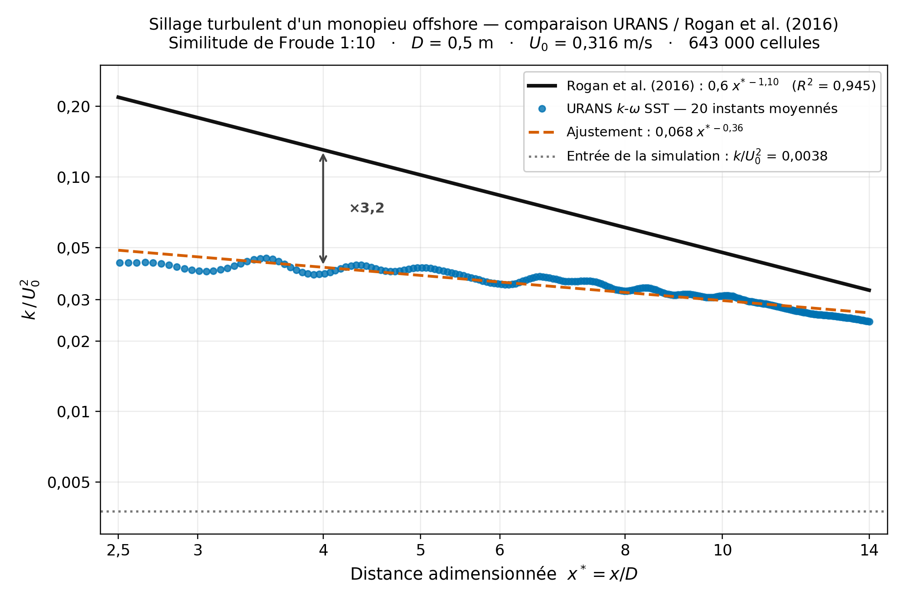
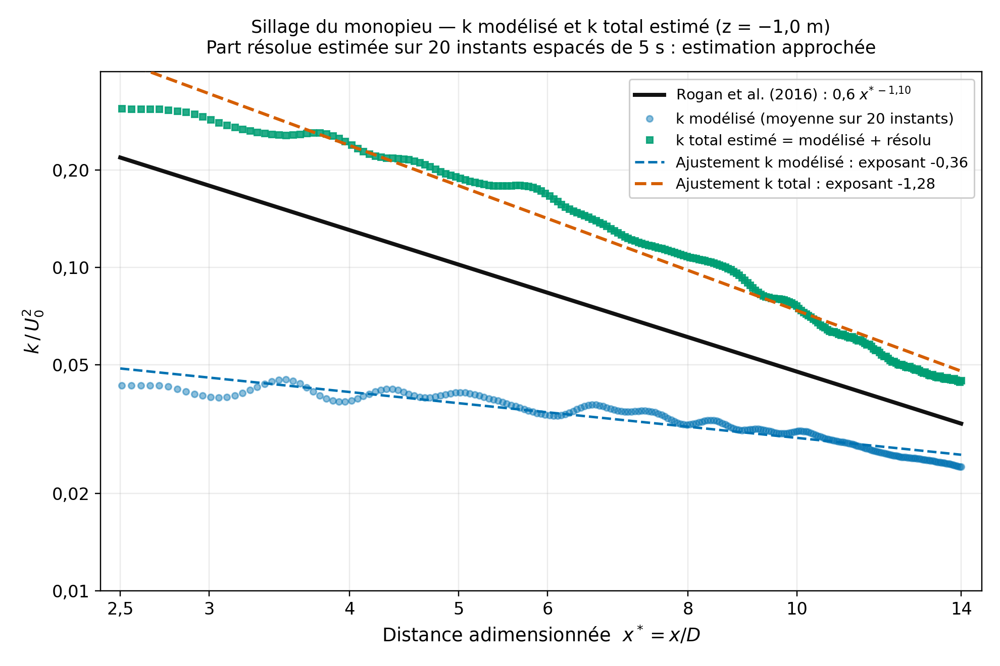

# Sillage turbulent d'un monopieu offshore — URANS k-ω SST (OpenFOAM v2112) comparé à Rogan et al. (2016)

**Projet personnel**, réalisé seul et de ma propre initiative, à partir du sujet et des fichiers du TP *Fluides turbulents par la CFD* (Master 2 Mécanique, parcours Modélisation et Simulation Numérique, Université de Caen Normandie).

La géométrie (`cylinder.stl`), les schémas numériques (`fvSchemes`) et plusieurs dictionnaires proviennent des fichiers du TP.



---

## Ce que j'ai fait

- Réécriture du domaine de calcul (`blockMeshDict`) à l'échelle modèle 1:10, selon la similitude de Froude.
- Réglage du solveur et des sorties (`controlDict`, `fvSolution`, `forces`), des conditions d'entrée (`0/U`, `0/k`, `0/omega`) et du raffinement (`snappyHexMeshDict`). Choix du modèle k-ω SST.
- Ajout de l'échantillonnage du sillage (`sampleDict`, `sampleDictZ`).
- Calcul de 300 s simulées sur 4 processus (environ 9 h).
- Moyenne de k sur 20 instants, ajustement en loi de puissance et comparaison à la loi expérimentale de Rogan et al. (2016) avec un script Python (`scripts/plot_rogan.py`).
- Analyse de l'écart obtenu, puis estimation de la part résolue de l'énergie turbulente pour tester l'interprétation (`scripts/tke_totale.py`).

---

## Configuration

| Paramètre | Valeur |
|---|---|
| Échelle | modèle 1:10 (similitude de Froude) d'un monopieu de 5 m dans un courant de 1 m/s |
| Diamètre D | 0,5 m |
| Vitesse U₀ | 0,3162 m/s |
| Viscosité ν | 1 × 10⁻⁶ m²/s |
| Reynolds Re = U₀D/ν | ≈ 1,6 × 10⁵ |
| Domaine | 10 × 5 × 2,5 m (5D en amont, 15D en aval, 10D de large, 5D de profondeur) |
| Maillage de fond | blockMesh 100 × 50 × 13 (0,1 × 0,1 × 0,19 m) |
| Raffinement | snappyHexMesh niveau 2 (0,025 m = D/20) sur le pieu et dans une boîte x ∈ [−0,5 ; 5] m, y ∈ [−1 ; 1] m, z ∈ [−1,5 ; 0] m, sans couches limites |
| Cellules | 642 882 (`checkMesh` : Mesh OK) |
| Modèle | URANS k-ω SST, lois de paroi |
| Solveur | pimpleFoam, Euler implicite, `linearUpwind` pour U |
| Pas de temps | adaptatif, Co max = 1 |
| Durée simulée | 300 s, 4 processus, 32 251 s de calcul |

**Conditions aux limites** : vitesse uniforme en entrée, avec k = 3,75 × 10⁻⁴ m²/s² (soit k/U₀² ≈ 0,004) et ω = 1,01 s⁻¹. Fond sans glissement avec lois de paroi. Surface libre traitée comme un toit rigide. Faces latérales et sortie en gradient nul.

---

## Post-traitement

- Ligne d'échantillonnage sur l'axe du sillage : y = 0, **z = −1,0 m**, x de 0,25 à 7 m, 270 points.
- Moyenne de k sur **20 instants**, de t = 205 à 300 s, tous les 5 s : `data/k_moyen_z1.txt`.
- `data/k_moyen.txt` : même moyenne, calculée à z = −0,5 m. Les fichiers bruts correspondants ne sont pas dans `postProcessing/`. Pour les régénérer, il faut remettre z = −0,5 dans `system/sampleDict`.
- Profil vertical de k à x = 5D : `postProcessing/sampleDictZ/300/`.

---

## Résultat

Ajustement sur 2,5 ≤ x/D ≤ 14 :

| | Loi en x* = x/D |
|---|---|
| Rogan et al. (2016), mesures en bassin | 0,6 · x\*^(−1,10), R² = 0,945 |
| Ma simulation | 0,068 · x\*^(−0,36) |

L'exposant simulé est environ **trois fois plus faible** : la décroissance de k dans le sillage est beaucoup trop lente. À x/D = 4, l'écart est d'un **facteur 3,2**.

**Statut : comparaison technique, pas une validation.** Le k modélisé seul ne reproduit pas la décroissance mesurée (voir ci-dessous).

### Test de la piste d'interprétation : ajout de la part résolue

Le k d'un modèle URANS représente seulement l'énergie turbulente **modélisée**. Une partie des fluctuations, en particulier le lâcher tourbillonnaire, est **résolue** dans le champ U. Elle n'est donc pas incluse dans la moyenne de k. Les mesures, elles, contiennent la TKE totale. J'ai donc estimé cette part résolue à partir des profils de U sur les mêmes 20 instants (`postProcessing/sampleDict/*/axeSillage_U.xy`) :

**k_total = ⟨k_modélisé⟩ + k_résolu**, avec k_résolu = ½ [σ²(Ux) + σ²(Uy) + σ²(Uz)], les variances étant calculées sur les 20 instants (`scripts/tke_totale.py`, résultats dans `data/tke_totale_z1.txt`).



| | Exposant | Rapport Rogan / simulation à x/D = 4 |
|---|---|---|
| Rogan et al. (2016) | −1,10 | |
| k modélisé seul (20 instants) | −0,36 | 3,2 |
| k total estimé (20 instants) | −1,28 | 0,55 |
| k total estimé (10 premiers instants) | −1,37 | 0,53 |
| k total estimé (10 derniers instants) | −1,25 | 0,53 |

À x/D = 4, la part résolue représente environ **84 %** de k total.

**Lecture.** Une fois la part résolue ajoutée, la décroissance simulée (exposant −1,28) se rapproche nettement de la décroissance mesurée (−1,10), et le résultat reste stable quand on ne garde que la moitié des instants. L'essentiel de l'écart initial venait donc de la comparaison d'un k modélisé seul à une TKE mesurée totale. Le niveau est en revanche surestimé d'un facteur 1,8 environ. Causes possibles, non démontrées ici : un lâcher tourbillonnaire trop régulier et trop intense en URANS avec une turbulence ambiante faible, la différence d'échelle (1:10 contre 1:50), et un échantillonnage grossier (20 instants espacés de 5 s, pour une période de lâcher d'environ 8 s estimée avec St ≈ 0,2).

**Statut : estimation technique approchée, pas une validation.**

---

## Limites connues

- **Échelle** : les essais de Rogan et al. sont à l'échelle 1:50, cette simulation à 1:10.
- **Turbulence d'entrée** : le niveau imposé (k/U₀² ≈ 0,004) n'a pas été calé sur celui des essais.
- **Champ lointain** : la boîte de raffinement s'arrête à x/D = 10, alors que la comparaison va jusqu'à x/D = 14. Au-delà, les mailles sont quatre fois plus grosses.
- **Entrée** : le profil de vitesse est uniforme, sans couche limite de fond.
- **Fond** : y⁺ moyen ≈ 1 165, au-delà du domaine d'usage des lois de paroi. La couche limite de fond n'est pas représentée. Sur le pieu, y⁺ moyen ≈ 170 (de 40 à 616).
- **Surface libre** : traitée comme un toit rigide, sans vagues ni déformation de surface.
- **Schéma temporel** : Euler, d'ordre 1, donc diffusif pour un sillage instationnaire.
- **Convergence** : pas d'étude de convergence de maillage sur ce cas 3D dans ce dépôt.

---

## Structure du dépôt

    case/            0/, constant/, system/ (sans le maillage polyMesh, régénéré par blockMesh puis snappyHexMesh)
    postProcessing/  efforts, y+, profils de k et U dans le sillage
    data/            moyennes de k (k_moyen_z1.txt : z = -1,0 m ; k_moyen.txt : z = -0,5 m ; tke_totale_z1.txt : k modélisé, résolu et total)
    scripts/         plot_rogan.py, tke_totale.py
    figures/         comparaison_rogan.png, tke_totale.png

Les résultats de calcul complets (environ 16 Go) ne sont pas publiés.

---

## Reproduire

Séquence indicative, à lancer depuis `case/` avec OpenFOAM v2112 (le dépôt ne contient pas de script `Allrun`) :

```bash
blockMesh
snappyHexMesh -overwrite
checkMesh
decomposePar
mpirun -np 4 pimpleFoam -parallel
reconstructPar -time '205:300'
for t in $(seq 205 5 300); do postProcess -func sampleDict -time $t; done
cat postProcessing/sampleDict/*/axeSillage_k.xy \
  | awk '{s[$1]+=$2; n[$1]++} END {for (x in s) printf "%.6f %.8f\n", x, s[x]/n[x]}' \
  | sort -g > ../data/k_moyen_z1.txt
cd .. && python3 scripts/plot_rogan.py && python3 scripts/tke_totale.py
```

---

## Référence

C. Rogan, J. Miles, D. Simmonds, G. Iglesias. *The turbulent wake of a monopile foundation.* Renewable Energy, 93, 180–187, 2016. https://doi.org/10.1016/j.renene.2016.02.050

---

## Auteur

Zied Jerbi — Master 2 Mécanique, parcours Modélisation et Simulation Numérique, Université de Caen Normandie
zied.jerbi@etu.unicaen.fr